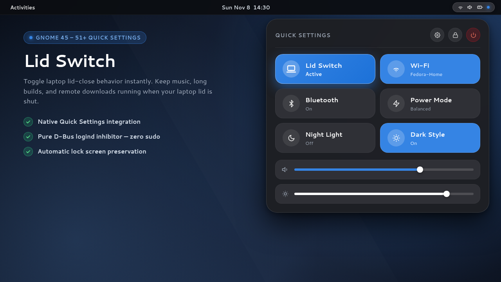
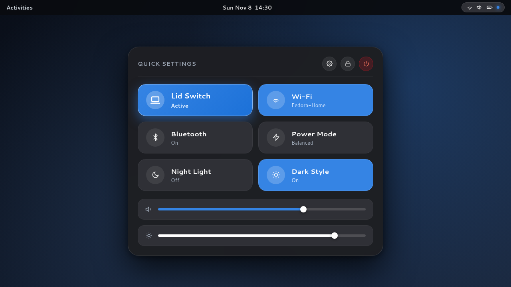
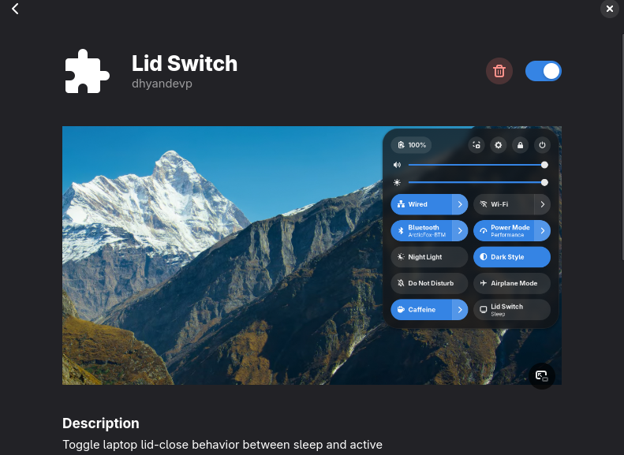
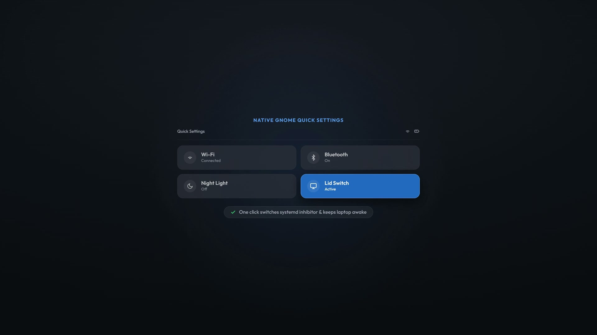

<div align="center">

# 💻 Lid Switch

### Instant control over laptop lid-close behavior in GNOME.

Keep downloads, audio, compiling, and docked setups running when your laptop lid is closed.

<br/>

[](https://extensions.gnome.org/extension/11675/lid-switch/)
[](https://gitlab.gnome.org/GNOME/gnome-shell)
[](https://systemd.io/)
[](LICENSE)
[-success?style=for-the-badge)](#-security--architecture)

<br/>

<a href="https://extensions.gnome.org/extension/11675/lid-switch/">
  
</a>

<br/><br/>

[](https://extensions.gnome.org/extension/11675/lid-switch/)

</div>

---

## 🌟 Visual Showcase

<div align="center">
<table>
  <tr>
    <td width="52%" align="center">
      <b>Native Quick Settings & Status Indicator</b><br/><br/>
      <a href="https://extensions.gnome.org/extension/11675/lid-switch/">
        
      </a>
      <br/>
      <em>One-click toggle with real-time status pill in top bar</em>
    </td>
    <td width="48%" align="center">
      <b>GNOME Extension Manager Listing</b><br/><br/>
      <a href="https://extensions.gnome.org/extension/11675/lid-switch/">
        
      </a>
      <br/>
      <em>Verified and available on <a href="https://extensions.gnome.org/extension/11675/lid-switch/">extensions.gnome.org/extension/11675/lid-switch/</a></em>
    </td>
  </tr>
</table>
</div>

### 🎬 Interactive Video Demo

<p align="center">
  <a href="https://github.com/dhyandevp/lid-switch/raw/main/assets/lid-switch-demo.mp4">
    
  </a>
  <br />
  <em>▶ Click preview image above to watch 1080p demonstration video (assets/lid-switch-demo.mp4)</em>
</p>

---

## 💡 Why Lid Switch?

Most modern Linux laptops automatically suspend when the lid is closed. Disabling this usually requires editing `/etc/systemd/logind.conf` with `sudo`, managing fragile scripts, or remembering to manually turn off screen lock.

**Lid Switch** delivers a clean, reliable, non-destructive solution:

- 🔘 **Native Quick Settings Integration**: One click in the top-right system tray switches between **Active** and **Sleep**.
- 📍 **Top Bar Indicator**: Clean icon in the panel status capsule tells you at a glance when lid suspension is disabled.
- ⚡ **Pure D-Bus Logind Inhibitor**: Leverages `org.freedesktop.login1.Manager.Inhibit` directly. Zero latency, instant response.
- 🛡️ **Smart Lock Preservation**: Suppresses screensaver lock while active so closing your lid doesn't interrupt presentations, external displays, or docked mode. Automatically restores your exact original lock preference when toggled back to sleep.
- 🔒 **Zero Root Needed**: 100% user-space operation. Never modifies `/etc` or system configuration files.

---

## 🚀 Installation

### Option 1: 1-Click Install via GNOME Extensions (Recommended)

1. Open **[extensions.gnome.org/extension/11675/lid-switch/](https://extensions.gnome.org/extension/11675/lid-switch/)**
2. Toggle the switch to **ON** and confirm **Install**
3. Alternatively, search for **Lid Switch** in the **Extension Manager** desktop app and click **Install**

---

### Option 2: Full Installer (Extension + CLI Companion)

Clone the repository and run the automated installer:

```bash
git clone https://github.com/dhyandevp/lid-switch.git
cd lid-switch
./install.sh
```

The installer:
- Deploys `lid-switch` to `~/.local/bin/`
- Installs the extension to `~/.local/share/gnome-shell/extensions/lid-switch@dhyandevp/`
- Enables the extension in GNOME Shell

> **Note:** If this is your first GNOME extension install, log out and log back in (or press `Alt+F2` then `r` on X11) so GNOME Shell discovers it.

---

### Option 3: Manual Extension ZIP Install

```bash
gnome-extensions install --force lid-switch@dhyandevp.shell-extension.zip
gnome-extensions enable lid-switch@dhyandevp
```

---

## 🖥️ Usage

### 1. GNOME Quick Settings

Click the system menu in the top-right corner of your desktop. Toggle **Lid Switch**:
- **Sleep** (default): Normal laptop suspend when lid is shut.
- **Active**: Laptop stays awake with lid closed (music, downloads, Docker, builds continue running).

---

### 2. Command Line Interface

A standalone CLI companion is included for terminal use, scripts, and keybindings:

```bash
lid-switch on       # Keep running when lid is closed
lid-switch off      # Normal laptop suspend on lid close
lid-switch toggle   # Flip between active and sleep
lid-switch status   # Output 'active' (exit 0) or 'inactive' (exit 1)
```

#### Custom Keyboard Shortcut:
Bind `lid-switch toggle` in **GNOME Settings** → **Keyboard** → **Keyboard Shortcuts** → **Custom Shortcuts** to toggle lid behavior with a single keystroke.

---

## 🛠️ Security & Architecture

```
                     ┌─────────────────────────────┐
                     │   Quick Settings Toggle /   │
                     │      lid-switch (CLI)       │
                     └──────────────┬──────────────┘
                                    │
                  ┌─────────────────┴─────────────────┐
                  ▼                                   ▼
        [ State: ACTIVE ]                   [ State: SLEEP ]
  - Inhibits handle-lid-switch        - Terminates inhibitor
  - Disables screensaver lock         - Restores original lock setting
  - Sets GSettings power (fallback)   - Restores power suspend actions
```

1. **Logind D-Bus Inhibit**: Acquires `handle-lid-switch` lock with `block` mode via systemd logind. The Linux kernel and display manager are cleanly informed to bypass lid-close suspend.
2. **Safe Lock Handling**: Reads `org.gnome.desktop.screensaver lock-enabled`, saves existing preference to user state (`0700` / `0600` permissions), and restores it immediately upon deactivation.
3. **Cross-Distro Compatibility**: Automatically checks for power schema keys before reading/writing, preventing errors across diverse Linux distros.

---

## 📋 Compatibility Matrix

| Distribution / Desktop | Version | Status |
|------------------------|---------|--------|
| **Fedora**             | 40, 41, 42, 43, 45+ (GNOME 51+) | Verified (Native) |
| **Ubuntu**             | 22.04 LTS, 24.04 LTS, 24.10+ | Verified |
| **Arch Linux**         | Rolling (systemd) | Verified |
| **Debian**             | 12 (Bookworm)+ | Verified |
| **GNOME Shell**        | 45, 46, 47, 51+ | Verified |

---

## 📂 Project Structure

```
.
├── assets/               # Showcase screenshots & demo video
├── bin/
│   └── lid-switch        # Executable CLI companion
├── extension/
│   ├── metadata.json     # GNOME Shell extension metadata (EGO v6)
│   └── extension.js      # Quick Settings SystemIndicator & QuickToggle
├── tests/
│   └── test_cli.sh       # Automated regression test suite
├── install.sh            # One-step installer
├── uninstall.sh          # Clean uninstaller
├── LICENSE               # MIT License
└── README.md             # Documentation
```

---

## 🧪 Testing

Run automated CLI and regression tests:

```bash
./tests/test_cli.sh
```

---

## 🗑️ Uninstallation

To cleanly remove both extension and CLI helper:

```bash
./uninstall.sh
```

Restores all screensaver and power preferences to system defaults and removes installed files.

---

## 📄 License

MIT © [dhyandevp](https://github.com/dhyandevp)
